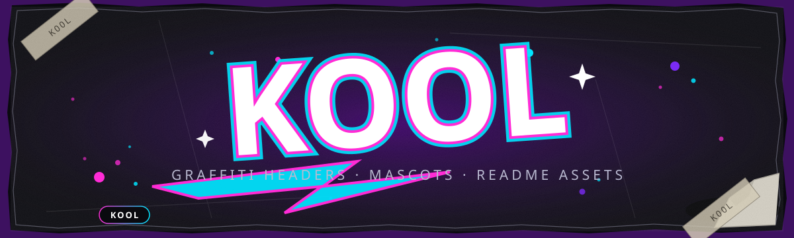

# dsh-sensenova-image



商汤 **SenseNova U1 / U1.5** 生图插件 for DeepSeek Harness (dsh)：一个住在 dsh 右栏的**生图工作台**（无限画布 / 并发队列 / 蒙版重绘 / 版本树），外加 5 个 agent 工具和聊天里的生图工具卡片。本文档以 `src/index.ts` 与 `client/client-v4.js` 的实际实现为准。

- 协议：OpenAI-compatible（`https://token.sensenova.cn/v1`，`/v1/images/generations` 文生图、`/v1/chat/completions` 图像编辑/增强）
- 宿主：dsh **0.2.0-rc.2**（peer 依赖 `@deepseek-ai/cordis >=4.0.1`、`dsh-tools >=0.1.1-rc.2 <0.3.0-0`）
- 主题：全部颜色走 dsh 设计令牌（`--dsw-alias-*`），自动跟随宿主亮/暗主题，旧宿主回退暗色

## 功能全集

### 工作台（dsh 右栏 tab）

侧栏左下角「生图」按钮（或 dsh-better-sidebar 的「+」菜单）打开右栏 tab，与文件浏览器并排，不遮挡聊天。六个模式 tab：

| Tab | 功能 |
|-----|------|
| ✎ 生图 | 生成表单 + 最近 12 张缩略条 + 提示词库 + i2i 锚点条 |
| ⚡ 队列 | 运行中/等待/完成/失败统计，逐项取消、失败重试、elapsed 秒表 |
| 🎨 画布 | Konva 无限画布：缩放/平移/框选/对齐/分组、浮动操作条、右键菜单、全屏模式 |
| 🖼 画廊 | 全部图网格、只看收藏、收藏/取消、进灯箱 |
| ⇄ 对比 | 选 2-4 张图：2 张 overlay 滑杆对比 / 多张网格对比 |
| ⚙ 设置 | Key 状态徽标、默认参数总览、清空画布、快捷键速查、提示词库管理 |

### 生成（生图 tab）

- 提示词（≤2000 字，字数计数）+ **⭐ 收藏到提示词库**（最近/收藏两组，设置页可管理）
- **多参考图**（≤4 槽，Midjourney 式）：每槽选角色（参考/风格/角色/构图）+ 强度滑块 10–100%；服务端把角色+强度翻译成措辞档位（严格遵循/重点遵循/适度参考/仅作轻微灵感）拼进 prompt（API 无数值权重参数）
- **风格预设 8 种**：电影/摄影/动漫/油画/3D/水墨/像素/建筑，点击追加风格后缀
- **负面提示词** + **种子**（-1 随机，🎲 随机按钮）；上游若不认扩展字段自动降级重试并在结果标注 `degraded`
- **比例预设 8 种**（1:1 / 3:4 / 4:3 / 2:1 / 21:9 / 9:16 / 3:2 / 7:5）
- **模型选择**：默认（配置值）/ sensenova-u1.5-lite / sensenova-U1 / sensenova-U1.5
- **画质档 2K/4K** + **张数 1–8**（并发生成，4 列网格落图，单张失败不拖垮其他）
- i2i：选中画布上的 done 图即成锚点，表单切「编辑指令」模式，结果挂在原图右侧（`parentId` 链接）

### 编辑与蒙版（画布 tab）

- **浮动操作条**（选中单图跟随）：🔀 变体 / ✨ 增强（4K 清晰化+去水印，走 `/api/sensenova/enhance`）/ 🖌 重绘 / 🧽 消除 / 🪄 抠图（去背景换纯白）/ ⬛ 扩图 / 🤖 问（把图+画布上下文发进当前会话）/ ⬇ 下载 / 🗑 删除
- **蒙版局部重绘**：画笔涂抹高亮区域 → 合成「原图+标注板」走 i2i，prompt 自动拼「仅修改高亮区域，未标注部分严格保持原样」；画笔四参数：大小 8–200px、不透明度、硬度、羽化
- **消除笔**：预填清除指令（删物体/文字/水印，背景自然延伸填补），可改
- **扩图 outpaint**：比例弹层 → 原图居中合成白边画布走 i2i
- 画布：滚轮缩放（指针锚点）、空格/中键平移、F 适应画面、Shift 多选/框选、对齐/等距分布、成组/解组、undo/redo（cap 60）、拖入/粘贴图片即成节点、文档防抖自动保存
- **全屏画布**：Esc 退出；**导出整画布** = 全部可见 done 图按布局合成一张 PNG（2x 超采样，底色随主题）

### 滤镜与版本树（灯箱）

双击节点或从画廊进入灯箱：

- 缩放 +/−/0（25%–400%）、Esc 关闭
- **🔍 2x / 4x 放大重生成**（请求尺寸限定在已验证 SIZES 线内，≤2752）
- **调整（滤镜）**：亮度/对比/饱和三滑块实时预览，「应用」保存为新节点（canvas 像素重绘，非 CSS 滤镜），挂进版本树
- **版本树**：变体/增强/重绘/扩图/调整产生的衍生图按 `parentId` 组成衍生链，左栏树状跳转（防环：A↔B 自引用死循环被 visited 集合挡住）
- **导出**：PNG（无损，可嵌入提示词/参数到 tEXt 元数据）/ JPG / WebP + 质量滑块；**复制图像**到系统剪贴板
- 收藏（★）、删除、原始下载、📋 复制参数、⤵ 回填参数（把这张图的 prompt/负面/尺寸/模型/种子/参考图整体回填到生图表单）

### 历史

- 画布文档（`{nodes[], camera}`）存 `~/.dsh/storages/dsh-sensenova-image-canvas.json`（≤300 节点，8MB 上限，原子写），刷新/重开不丢
- 生成结果全部落盘 `~/.dsh/storages/sensenova-images/<id>.<ext>`，经 `/api/sensenova/image/<id>` 长缓存服务
- 旧版 web 面板历史 `~/.dsh/storages/dsh-sensenova-image.json`（cap 12）仍在维护（`/api/sensenova/history`）

### agent 联动

注册 5 个 dsh 工具 + 系统提示区块（`sensenova-canvas`，携带画布实时快照）：

| 工具 | 说明 |
|------|------|
| `sensenova_generate_image` | 文生图/图生图（`reference` 单图或 `refs[]` 多参考图，含 role/strength）；结果自动落盘并实时出现在打开的画布上（SSE `canvas:update`） |
| `sensenova_edit_image` | 1–3 张图 + 编辑指令（换色/改字/增删元素），走 chat/completions，结果落画布 |
| `sensenova_enhance_image` | 清晰化/4K 超分 + 去水印（`removeWatermark` 默认 true） |
| `sensenova_canvas_get_state` | 读画布全部节点 id/坐标/尺寸/来源 prompt + 相机；用户说「画布上那张」时先调它定位 |
| `sensenova_canvas_place_image` | 把本地图/URL/dataURL 摆到画布指定坐标（省略坐标自动右移排版） |

约定：带【来自生图画布】前缀的消息 = 用户从画布发来的上下文（附选中图）。

### 工具卡片（聊天里）

`sensenova_generate_image` 的工具结果在聊天流里渲染成图卡（`GenToolView`）：缩略图 + 提示词 + **📌 插入画布**按钮——点击 POST `/api/sensenova/canvas/nodes` 落盘入画布，画布开着的话经 SSE 实时刷新。

### 设置卡片（dsh 设置页）

设置 → 插件 → `dsh-sensenova-image`（`settings.section` slot，label「SenseNova 生图」）：

- **🔑 API Key**：密码框 + 👁 明文切换；留空 = 不修改（保留现有/环境变量值）
- **🌐 baseUrl**：默认 `https://token.sensenova.cn/v1`
- **🎛️ 模型**：下拉预设（保留当前 / u1-fast / U1 / U1.5 / 自定义 id），每档带说明
- **💾 保存设置**：POST `/api/sensenova/config` 立即生效并持久化到 settings namespace
- **🔌 测试连接**：先 GET `/api/sensenova/status` 看 `keyConfigured`（未配 key 直接提示，不打上游），再 POST `/api/sensenova/test` 实测上游 `/v1/models`——成功显示可见模型列表，失败显示状态码与响应摘要；不消耗生图配额

## 安装（dsh 0.2.0-rc.2 宿主）

### 方式 A：link 源码目录（开发推荐，写源文件即生效）

```sh
# 1. 构建
cd dsh-sensenova-image
npm install --legacy-peer-deps
npm run build        # esbuild → dist/index.js

# 2. 装进 profile（pnpm link 语义，dsh plugin 是 pnpm 的薄封装）
dsh plugin --profile web add D:/coding/dsh-sensenova-image
# 等价：编辑 ~/.dsh/profiles/web/package.json 加
#   "dsh-sensenova-image": "link:D:/coding/dsh-sensenova-image"
# 然后在 profile 目录 pnpm install

# 3. 注册进 bundle（~/.dsh/profiles/web/package.json 的 dsh.profile.bundles
#    数组里加 "dsh-sensenova-image"；bundle patch 见 cordis.patch.yml，缺省空配置可启动）

# 4. 启动
dsh --profile web --no-open --port 5180
```

改 `src/index.ts` 后需重新 `npm run build`；改 `client/client-v4.js` 即时生效但浏览器要**关 tab 重开**（模块缓存不热更）。

### 方式 B：npm 包

```sh
dsh plugin --profile web add dsh-sensenova-image
```

插件元数据都在 `package.json` 的 `dsh` 字段里：`dsh.bundle.patch` 指向 `cordis.patch.yml`（服务端装配），`dsh.client` 指向 `client/client-v4.js`（web 客户端模块，注入 `@deepseek-ai/dsh-client-runtime`）。

## 配置

dsh 设置页 → 插件 → `dsh-sensenova-image`（或 `cordis.patch.yml` 的 `config:`，或环境变量）：

| 项 | 必填 | 默认 | 说明 |
|----|------|------|------|
| `apiKey` | ✅* | — | `platform.sensenova.cn → 控制台 → 管理中心 → API-Key 管理 → 创建`，`sk-...` |
| `baseUrl` | — | `https://token.sensenova.cn/v1` | OpenAI-compatible 地址，**不要**改成 `api.sensenova.cn`（403） |
| `model` | — | `sensenova-u1.5-lite` | 文生图（u1-fast 已于 2026-10 下线）；编辑/增强用 `sensenova-U1.5`（chat/completions） |
| `timeoutMs` | — | `60000` | 单次请求超时（3000–120000） |

\* 三种配法任选其一，优先级：设置页 apiKey > 环境变量 `SENSENOVA_API_KEY`（或 `SENSENOVA_TOKEN`）。

- 环境变量（Windows 注意：`setx` 后要**重启 dsh 进程**才可见——子进程不继承启动后新设的用户变量）：
  ```powershell
  setx SENSENOVA_API_KEY "sk-你的key"
  ```
- 未配 key 时工具不抛错，返回 JSON 指引（如何建 key、两种配法），agent 会转述给你。
- 设置区块采用 `inject(['settings'])` 优雅降级：宿主没有 settings 服务时入口配置原样生效，不报错。

## 快捷键

工作台内按 **?** 随时打开速查层（输入框聚焦时不抢键）。

| 按键 | 作用 | 区域 |
|------|------|------|
| ⌘ / Ctrl + Enter | 生图 | 生图表单 |
| Enter | 生图（文生图或编辑选中图） | 画布悬浮 prompt bar |
| 滚轮 | 缩放（指针锚点） | 画布 |
| Space + 拖动（或中键） | 平移 | 画布 |
| F | 适应画面 | 画布 / 全屏画布 |
| Del | 删除选中节点 | 画布 |
| Ctrl + V | 粘贴图片为节点 | 画布 |
| 双击节点 | 打开灯箱 | 画布 |
| 右键节点 | 上下文菜单（重绘/扩图/复制/删除/回填参数） | 画布 |
| Esc | 退出全屏画布 / 关帮助层 / 关灯箱 / 清空选中 / 退蒙版（**不关工作台**，切 tab 即离开） | 全局 |
| + / − / 0 | 灯箱缩放 / 1:1 | 灯箱 |
| ? | 打开快捷键速查 | 工作台 |

## 常见问题

**Q：打开 `http://127.0.0.1:5180` 提示未授权 / 401？**
dsh web 有 browser-trust 栅栏，必须带启动时颁发的 token：用控制台输出的完整 URL（形如 `http://127.0.0.1:5180/?token=...`）。**token 每次重启都会变**，重启后旧链接失效，用新打印的。

**Q：`/api/sensenova/image/xxx.png` 一直 404 / 401（prefix 路由坑）？**
dsh webserver 的 prefix 匹配是 `pathname.startsWith(path + '/')`。注册 prefix 路由时路径**不能带尾斜杠**：写成 `/api/sensenova/image/` 会变成匹配 `/api/sensenova/image//xxx` 双斜杠永不命中，静默掉进 fallback 的 401 栅栏。本插件注册的是 `/api/sensenova/image`（见 `src/index.ts` 图片文件服务段）。

**Q：点了「测试连接」说未检测到 API Key？**
`GET /api/sensenova/status` 返回 `keyConfigured: false`。三选一：设置卡片填 Key 并「保存设置」；`setx SENSENOVA_API_KEY` 后**重启 dsh**；profile 的 cordis.patch.yml 里 `config: { apiKey: ... }`。

**Q：`setx` 了环境变量但工具仍说没 key？**
Windows 图形会话里 `setx` 写的是注册表，已经在跑的 dsh 进程看不到。杀掉 dsh 重开（新开的进程才继承）。

**Q：模型返回 404 / 不支持图像？**
编辑/增强走 chat/completions，需要多模态模型：模型选 `sensenova-U1.5`（或控制台模型广场确认的实际 id）。纯文生图用 `sensenova-u1.5-lite`。baseUrl 必须是 `https://token.sensenova.cn/v1`（不是 `api.sensenova.cn/compatible-mode/v1`，会 403）。

**Q：负面提示词/种子报 400？**
这两个是 SenseNova 扩展字段。服务端遇到 400/422 会自动去掉重试一次并在响应里标 `degraded: ["negative_prompt/seed"]`，生成不会挂，只是这两项没生效。

**Q：改了 client-v4.js 没生效？**
浏览器模块缓存：关掉工作台所在 tab 重开（不是刷新页面就行）。调试时看 `window.__snxDebug`（`step` / `tabBodyFired` 等）确认新代码加载了。

**Q：画布清空后图片文件还在吗？**
在。清空只清文档索引（`dsh-sensenova-image-canvas.json` 的 nodes），文件保留在 `~/.dsh/storages/sensenova-images/`。

## 文档

- 平台：https://platform.sensenova.cn/docs
- U1.5 预览：https://github.com/OpenSenseNova/SenseNova-U1/blob/main/docs/u1.5_preview_CN.md
- 开发交接（启动、坑、待做）：见 `FOR-OTHER-SESSIONS.md`；画布底座设计见 `WORKBENCH-PLAN.md`
